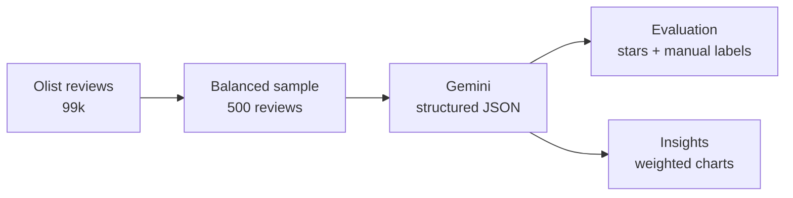
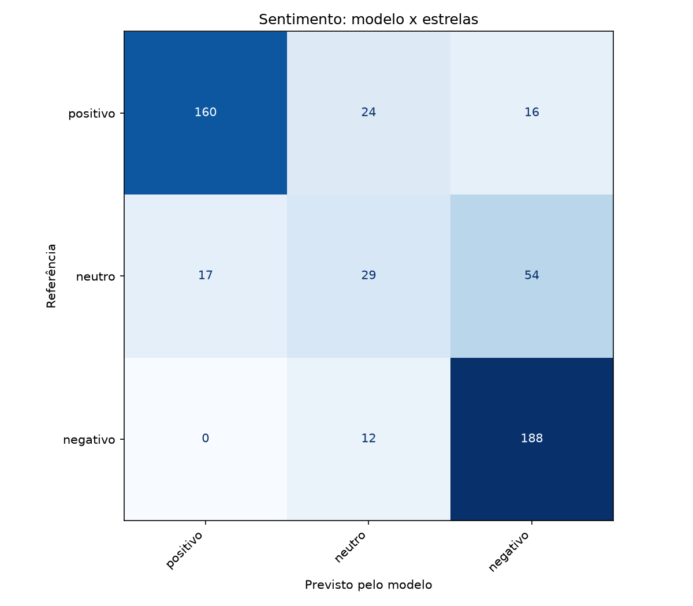
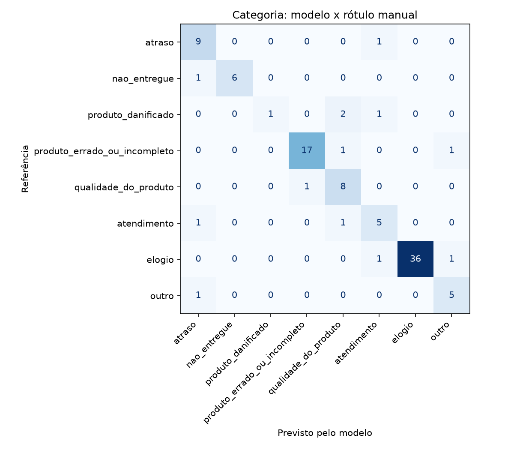
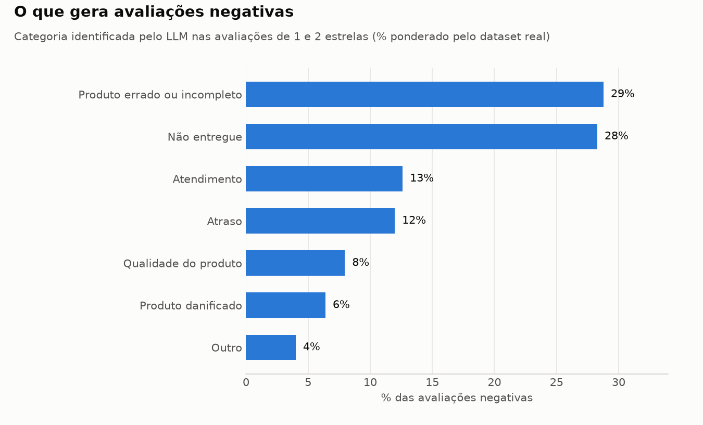
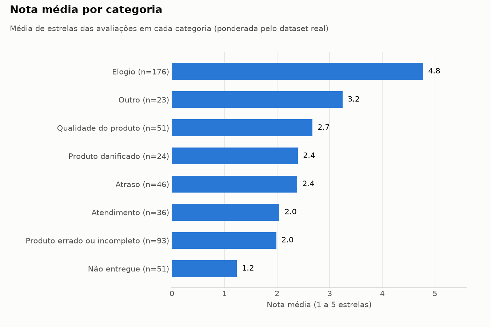

# review-insights-llm

LLM-powered analysis of customer reviews: sentiment, issue category and summary extraction with Gemini, evaluated against real ratings and manual labels.

> 🔗 **Live demo:** https://review-insights-llm.streamlit.app

---

## Overview

Online stores receive thousands of free-text reviews that nobody has time to read. This project uses a Large Language Model to turn each review into structured data — **sentiment**, **issue category** and a **one-line summary** — and then measures how reliable that output actually is.

**Key results**

- **87.0% accuracy** on issue category against 100 manually labeled reviews (77.8% before label review — see [Evaluation](#evaluation))
- **75.4% accuracy** on sentiment against customer star ratings (500 reviews)
- **Insight:** most negative reviews are about operations, not the product — wrong/incomplete and undelivered orders account for **57%** of complaints

## Pipeline



## Data

- **Source:** [Brazilian E-Commerce Public Dataset by Olist](https://www.kaggle.com/datasets/olistbr/brazilian-ecommerce) (Kaggle), real reviews in Portuguese with a 1–5 star rating.
- The dataset has **99,224 reviews**, of which **37,492** include a written comment.
- Ratings are highly unbalanced (18,211 five-star vs. 2,084 two-star comments), so I drew a **balanced sample of 500 reviews (100 per rating)**. Otherwise the model would be tested mostly on positive reviews.

## Approach

For each review, the model returns a JSON object validated by a Pydantic schema:

| Field | Values |
|---|---|
| `sentimento` | positive, neutral, negative |
| `categoria` | delay, not delivered, damaged product, wrong or incomplete product, product quality, customer service, praise, other |
| `resumo` | one-sentence summary |

Design decisions:

- **Structured output** (`response_schema`) instead of free text, so results become a reliable table.
- **The star rating is never sent to the model** — it is used only for evaluation, to avoid leaking the answer.
- **Temperature 0** for consistent outputs across runs.
- **Batches of 20 reviews per request**, which reduces token usage (the system prompt is sent 25 times instead of 500) and respects free-tier rate limits.
- **Automatic retries with exponential backoff** for temporary API errors (429/5xx), and **resumable runs**: results are saved after each batch.

Model: `gemini-3.1-flash-lite` via the Google AI Studio API (free tier). Estimated usage for 500 reviews: ~60k tokens.

## Evaluation

### Sentiment vs. star ratings (500 reviews)

Stars were mapped to sentiment (1–2 negative, 3 neutral, 4–5 positive).

| Accuracy | Macro F1 |
|---|---|
| 75.4% | 0.674 |

Star ratings are an imperfect reference: customers sometimes write positive text with 3 stars, or complain while giving 5. Neutral is the hardest class.



### Category vs. manual labels (100 reviews)

I manually labeled 100 reviews (20 per rating) without seeing the model's answers or the star ratings.

| Reference labels | Reviews | Accuracy | Macro F1 |
|---|---|---|---|
| Original manual labels | 99 | 77.8% | 0.663 |
| Revised labels (documented guidelines) | 100 | 87.0% | 0.779 |

After the first evaluation, I reviewed all 22 disagreements between the model and my labels. Some were labeling mistakes on my side (e.g. reviews that only mentioned the delivery date were labeled as "delay"), and others came from category boundaries that were not clearly defined. I wrote explicit labeling guidelines and revised 10 labels based on them.

All 10 revisions moved toward the model's answer, so I report both numbers for transparency. The original labels are kept in `data/processed/manual_labels_original.xlsx`.

- **Strongest category:** praise (F1 0.97).
- **Weakest category:** damaged product (recall 0.25) — the model tends to classify "arrived dirty / doesn't work" as a product quality issue.



**Labeling guidelines (summary)**

- When a review has two problems, the category follows the **root cause** (e.g. a defective product + no answer from support → damaged product).
- Mentioning the delivery date is not a delay; "not received yet" is *not delivered*, even if the customer mentions a delay.
- If part of the order has not arrived → not delivered; if everything arrived and the customer only comments on separate deliveries → praise or other.
- Different from the listing (size, color, specs) or missing parts/manual → wrong or incomplete product.
- Dissatisfaction caused by the customer's own mistake → other.

## Insights



- **Most complaints are about operations, not the product itself.** Wrong or incomplete orders (29%) and undelivered orders (28%) account for 57% of negative reviews; adding delays (12%), delivery and fulfillment issues make up about 7 in 10 negative reviews. Product quality and damage together account for only 14%.
- **Not receiving the order is the most damaging experience.** Reviews classified as "not delivered" have an average rating of 1.2 stars, versus 2.4 for delays.



Percentages and averages are **weighted** to reflect the real distribution of ratings in the dataset, since the sample is balanced (100 reviews per rating).

*Caveat:* categories were assigned by the LLM (87% agreement with manual labels). "Damaged product" has low recall, so its share is likely underestimated.

Examples of model summaries: [`results/exemplos_resumos.md`](results/exemplos_resumos.md)

## Project structure

```
review-insights-llm/
├── src/
│   ├── config.py                 # paths, model, sample size
│   ├── llm.py                    # Gemini client
│   ├── schema.py                 # output schema (Pydantic)
│   ├── prompts.py                # system prompt
│   ├── 01_test_api.py            # API connection test
│   ├── 02_prepare_data.py        # balanced sample
│   ├── 03_extract.py             # LLM extraction
│   ├── 04a_make_labeling_sheet.py
│   ├── 04_evaluate.py            # metrics and confusion matrices
│   ├── 05_insights.py            # weighted insights and charts
│   ├── conferir.py               # side-by-side check of reviews and outputs
│   └── list_models.py            # lists available Gemini models
├── data/
│   ├── raw/                      # Olist CSV (not versioned, download from Kaggle)
│   └── processed/                # sample, extractions, manual labels
└── results/                      # metrics, charts, error analysis
```

Code and comments are in Portuguese.

## How to run

1. Clone the repository and create a virtual environment:
   ```bash
   python -m venv .venv
   .venv\Scripts\activate        # Windows
   pip install -r requirements.txt
   ```
2. Get a free API key at [Google AI Studio](https://aistudio.google.com) and create a `.env` file based on `.env.example`:
   ```
   GEMINI_API_KEY=your_key_here
   ```
3. Download `olist_order_reviews_dataset.csv` from Kaggle and place it in `data/raw/`.
4. Run the pipeline:
   ```bash
   python src/01_test_api.py
   python src/02_prepare_data.py
   python src/03_extract.py      # set LIMITE = None in config.py to process all 500
   python src/04_evaluate.py
   python src/05_insights.py
   ```

## Limitations and next steps

- **Single label per review:** reviews with two problems lose information. Multi-label classification would solve this.
- **Single annotator:** manual labels were made by one person, so there is no inter-annotator agreement measure.
- **Small categories:** some categories have fewer than 10 labeled examples, so their metrics are noisy.
- **Prompt v2:** add the labeling guidelines to the prompt and compare against v1. Since the guidelines came from these same 100 reviews, the improvement measured on them may be optimistic.
- **Model comparison:** compare `flash-lite` with a larger `flash` model (quality vs. cost).
- **Live demo** with Streamlit.

## Data and license

- Data: [Olist Brazilian E-Commerce Public Dataset](https://www.kaggle.com/datasets/olistbr/brazilian-ecommerce), licensed under CC BY-NC-SA 4.0.
- Code: MIT License.

Developed by Bianca Miyazato — [LinkedIn](https://www.linkedin.com/in/biancamiyazato) · [GitHub](https://github.com/biancamiyazato)
